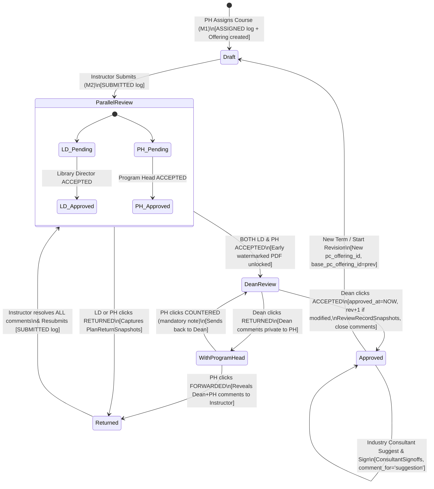

# Phase 2 — Unified Superset Schema & Integration Architecture Blueprint

**Generated:** 2026-11-28  
**Target Workspace:** `integrated-lpms/` (`integrated-lpms/server/` + `integrated-lpms/client/`)  
**Target Database:** Single Unified **MySQL 8.0** database (`unc_lpms_integrated`) via Sequelize `6.37.8` + `mysql2`  
**Priority Constraint:** 100% preservation of **Module 2 (Learning Plan Composition)** pages, UIs, components, validations, Copy-on-Write integrity, and foundational HCI sample data.

---

## 1. Entity Reconciliation & Unified Superset Table Matrix (48 Tables — Zero Dropped Attributes)

Every overlapping entity across Modules 1, 2, and 3 is consolidated into **ONE Unified Superset Table**. Module-exclusive tables are retained intact under the same MySQL schema, with all 16 SQLite-to-MySQL hazards remediated.

### 1.1 Overlapping Core Entities Reconciled (17 Unified Superset Tables)

| # | Unified Table Name (MySQL) | M1 Source | M2 Source | M3 Source | Unified Superset Columns, Types, FKs & Indexes |
|---|---|---|---|---|---|
| 1 | **`academic_periods`** | `academic_periods` | `academic_periods` | `academic_periods` | `academic_period_id` INT UNSIGNED PK AI; `label` VARCHAR(100) NN UNIQUE; `school_year` VARCHAR(20) NN; `semester` VARCHAR(30) NN; `is_active` BOOL NN def `false`; `sort_order` INT NN def `0`; `status` ENUM(`'Active'`,`'Closed'`) NN def `'Active'`; `closed_at` DATETIME NULL; `start_date`, `end_date`, `classes_start`, `prelim_exam`, `midterm_exam`, `semifinal_exam`, `final_exam` DATEONLY NULL; `created_at`, `updated_at`. |
| 2 | **`Users`** | `user_accounts` | `user_accounts` | `Users` | `user_id` INT UNSIGNED PK AI *(aliased `id`)*; `name` VARCHAR(150) NN *(aliased `full_name`, `display_name`)*; `email` VARCHAR(160) NN UNIQUE; `password_hash` VARCHAR(255) NN *(excluded from defaultScope/toJSON)*; `role` VARCHAR(60) NN def `'Instructor'` *(primary role)*; `roles` JSON NN *(array of canonical Title Case strings, e.g. `["Program Head","Instructor"]`)*; `active_role` VARCHAR(60) NN def `'Instructor'`; `status` VARCHAR(20) NN def `'Active'` (`'Active'\|'Disabled'`); `is_active` BOOL NN def `true` *(kept in sync with `status` via model hook)*; `faculty_id` INT UNSIGNED NULL; `industry_consultant_id` INT UNSIGNED NULL; `must_change_password` BOOL NN def `false`; `temp_password_expires_at` DATETIME NULL; `password_changed_at` DATETIME NULL; `last_login_at` DATETIME NULL; `failed_attempts` INT NN def `0`; `locked_until` DATETIME NULL; `reset_token_hash` VARCHAR(64) NULL; `reset_expires_at` DATETIME NULL; `privacy_consent_version` VARCHAR(20) NULL; `privacy_consented_at` DATETIME NULL; `signature_path` VARCHAR(255) NULL; `signature_iv` VARCHAR(32) NULL; `signature_tag` VARCHAR(32) NULL; `signature_mime` VARCHAR(32) NULL; `signature_key_version` INT NULL; `signature_uploaded_at` DATETIME NULL; `createdAt`, `updatedAt`. |
| 3 | **`Departments`** | `departments` | `Departments` | `Departments` | `dept_id` INT UNSIGNED PK AI *(aliased `id`)*; `name` VARCHAR(120) NN; `code` VARCHAR(20) NN; `dean` VARCHAR(100) NULL; `dean_email` VARCHAR(254) NULL; `stakeholder_id` INT UNSIGNED NULL FK→`Users.user_id` *(Dean `user_id`)*; `status` VARCHAR(20) NN def `'Active'` (`'Active'\|'Unlisted'\|'Archived'`); `academic_period_id` INT UNSIGNED NULL FK→`academic_periods.academic_period_id` *(aliased `period_id`)*; `createdAt`, `updatedAt`. UNIQUE `(code, academic_period_id)`. |
| 4 | **`faculty`** | `faculty` | `faculty` | *(none)* | `faculty_id` INT UNSIGNED PK AI *(aliased `id`)*; `name` VARCHAR(150) NN; `role` VARCHAR(64) NN def `'Instructor'` *(aliased `position`)*; `department` VARCHAR(120) NULL; `department_id` INT UNSIGNED NULL FK→`Departments.dept_id`; `employment_type` VARCHAR(40) NN def `'Full-time'`; `status` VARCHAR(20) NN def `'Active'` (`'Active'\|'On Leave'\|'Emeritus'\|'Inactive'`); `about` TEXT NULL; `sex` VARCHAR(16) NULL; `birthdate` DATEONLY NULL; `email` VARCHAR(150) NULL; `contact_number` VARCHAR(32) NULL; `academic_period_id` INT UNSIGNED NULL FK→`academic_periods.academic_period_id` *(aliased `period_id`)*; `created_at`, `updated_at`. |
| 5 | **`Programs`** | `programs` | `Programs` | `Programs` | `program_id` INT UNSIGNED PK AI *(aliased `id`)*; `code` VARCHAR(20) NULL; `name` VARCHAR(120) NN; `dept_id` INT UNSIGNED NOT NULL FK→`Departments.dept_id` *(aliased `department_id`)*; `program_head` VARCHAR(120) NULL; `program_head_id` INT UNSIGNED NULL FK→`faculty.faculty_id`; `stakeholder_id` INT UNSIGNED NULL FK→`Users.user_id` *(Program Head `user_id`)*; `status` VARCHAR(20) NN def `'Active'` (`'Active'\|'Unlisted'`); `academic_period_id` INT UNSIGNED NULL FK→`academic_periods.academic_period_id` *(aliased `period_id`)*; `createdAt`, `updatedAt`. INDEX `(code, academic_period_id)`. |
| 6 | **`industry_consultants`** | `industry_consultants` | `industry_consultants` | *(linked via `CourseConsultants`)* | `industry_consultant_id` INT UNSIGNED PK AI *(aliased `id`)*; `name` VARCHAR(150) NN; `email` VARCHAR(160) NULL; `user_id` INT UNSIGNED NULL FK→`Users.user_id`; `assigned_course_code` VARCHAR(30) NULL; `assigned_course_id` INT UNSIGNED NULL FK→`Courses.course_id`; `status` VARCHAR(20) NULL (`'Active'\|'Unavailable'\|'Offboarded'`); `status_overridden` BOOL NN def `false`; `academic_period_id` INT UNSIGNED NULL FK→`academic_periods.academic_period_id`; `created_at`, `updated_at`. |
| 7 | **`Courses`** | `courses` | `Courses` | `Courses` | `course_id` INT UNSIGNED PK AI; `course_no` VARCHAR(32) NN; `course_title` VARCHAR(150) NN; `credit` VARCHAR(50) NULL; `contact_hrs` VARCHAR(64) NULL; `classification` VARCHAR(100) NULL; `cmo` VARCHAR(100) NULL; `year_lvl` VARCHAR(32) NULL; `prerequisites_text` TEXT NULL; `term` VARCHAR(64) NULL; `semester` INT NN def `1`; `archived` BOOL NN def `false`; `academic_period_id` INT UNSIGNED NULL FK→`academic_periods.academic_period_id` *(aliased `period_id`)*; `createdAt`, `updatedAt`. |
| 8 | **`Prerequisites`** | `prerequisites` | `Prerequisites` | `Prerequisites` | `prerequisite_id` INT UNSIGNED PK AI; `course_id` INT UNSIGNED NN FK→`Courses.course_id`; `prerequisite_course_id` INT UNSIGNED NN FK→`Courses.course_id` *(aliased `course_prerequisite_id` for M1)*; `createdAt`, `updatedAt`. |
| 9 | **`ProgramCourseOfferings`** | `program_course_offerings` | `ProgramCourseOfferings` | `ProgramCourseOfferings` | `pc_offering_id` INT UNSIGNED PK AI; `course_id` INT UNSIGNED NN FK→`Courses.course_id`; `program_id` INT UNSIGNED NN FK→`Programs.program_id`; `dept_id` INT UNSIGNED NN FK→`Departments.dept_id`; `academic_period_id` INT UNSIGNED NULL FK→`academic_periods.academic_period_id`; `school_year` VARCHAR(20) NULL; `semester` VARCHAR(30) NULL; `revision_number` INT NN def `1`; `base_pc_offering_id` INT UNSIGNED NULL self-FK→`ProgramCourseOfferings.pc_offering_id` *(aliased `base_offering_id` for M3)*; `carried_from_offering_id` INT UNSIGNED NULL self-FK→`ProgramCourseOfferings.pc_offering_id`; `has_modifications` BOOL NN def `false`; `is_revision_incremented` BOOL NN def `false`; `approved_at` DATETIME NULL; `course_description` TEXT NULL; `createdAt`, `updatedAt`. **Non-unique INDEX `(course_id, program_id, academic_period_id)`** *(M1's unique `(course_id, program_id)` intentionally removed to support multi-term & historical revisions)*. |
| 10 | **`CourseOfferingAssignments`** | `course_offering_assignments` | `CourseOfferingAssignments` | `CourseOfferingAssignments` | `co_assign_id` INT UNSIGNED PK AI *(aliased `id`)*; `pc_offering_id` INT UNSIGNED NULL FK→`ProgramCourseOfferings.pc_offering_id`; `course_id` INT UNSIGNED NULL FK→`Courses.course_id`; `program_id` INT UNSIGNED NULL FK→`Programs.program_id`; `academic_period_id` INT UNSIGNED NULL FK→`academic_periods.academic_period_id` *(aliased `period_id`)*; `course_code` VARCHAR(32) NULL; `course_name` VARCHAR(150) NULL; `year_level` VARCHAR(32) NULL; `stakeholder_id` INT UNSIGNED NULL FK→`Users.user_id` *(Lead Instructor `user_id` — also accepts string `'1'` safely)*; `faculty_id` INT UNSIGNED NULL FK→`faculty.faculty_id` *(M1 Lead Faculty FK)*; `faculty_name` VARCHAR(150) NULL; `contributors` JSON NULL *(`[{faculty_id, faculty_name, user_id?}]`)*; `sections` JSON NULL; `status` VARCHAR(24) NN def `'Active'` *(M1 faculty-link status: `'Active'\|'On Leave'\|'Emeritus'\|'Inactive'\|'Unassigned'\|'Archived'`)*; `date_assigned` DATETIME NULL; `date_submitted` DATETIME NULL; `date_updated` DATETIME NULL; `official_confirmed_at` DATETIME NULL; `createdAt`, `updatedAt`. |
| 11 | **`AssignmentWorkflowLogs`** | *(none)* | `AssignmentWorkflowLogs` | `AssignmentWorkflowLogs` | `log_id` INT UNSIGNED PK AI; `co_assign_id` INT UNSIGNED NN FK→`CourseOfferingAssignments.co_assign_id`; `stakeholder_id` VARCHAR(20) NULL *(M2 compatibility)*; `actor_user_id` INT UNSIGNED NULL FK→`Users.user_id`; `actor_name` VARCHAR(150) NULL; `actor_role` VARCHAR(30) NN (`'INSTRUCTOR'\|'PROGRAM_HEAD'\|'LIBRARY_DIRECTOR'\|'DEAN'\|'INDUSTRY_CONSULTANT'\|'VPAA'`); `action_type` ENUM(`'ASSIGNED'`,`'SUBMITTED'`,`'RETURNED'`,`'ACCEPTED'`,`'APPROVED'`,`'FORWARDED'`,`'COUNTERED'`,`'Suggest'`) NN; `note` TEXT NULL; `is_viewed` BOOL NN def `false` *(M2 bell)*; `createdAt`, `updatedAt`. |
| 12 | **`ProgramOutcomes`** | *(none)* | `ProgramOutcomes` | `ProgramOutcomes` | `po_id` INT UNSIGNED PK AI; `program_id` INT UNSIGNED NN FK→`Programs.program_id`; `description` VARCHAR(500) NN; `peo_numbers` TEXT NN def `'[]'` *(JSON array)*; `ga_numbers` TEXT NN def `'[]'` *(JSON array)*; `createdAt`, `updatedAt`. |
| 13 | **`IntendedLearningOutcomes`** | *(none)* | `IntendedLearningOutcomes` | `IntendedLearningOutcomes` | `ilo_id` INT UNSIGNED PK AI; `co_id` INT UNSIGNED NN FK→`CourseOutcomes.co_id`; `description` VARCHAR(500) NN; `hours` INT NULL; `weeks` DECIMAL(4,2) NULL; `assessment_tool` VARCHAR(200) NULL; `is_orientation` BOOL NN def `false`; **M2 COAEP weights:** `prelim_weight` DECIMAL(5,2) NULL, `midterm_weight` DECIMAL(5,2) NULL, `semi_weight` DECIMAL(5,2) NULL, `final_weight` DECIMAL(5,2) NULL, `target` VARCHAR(255) NULL; **M3 COAEP targets:** `ied_level` ENUM(`'I'`,`'E'`,`'D'`) NULL, `target_students_percent` INT NN def `90`, `target_score_percent` INT NN def `60`; `createdAt`, `updatedAt`. |
| 14 | **`Topics` & `Subtopics`** | *(none)* | `Topics`, `Subtopics` | `Topics`, `Subtopics` | **`Topics`:** `topic_id` INT UNSIGNED PK AI; `title` VARCHAR(200) NN; `course_id` INT UNSIGNED NULL FK→`Courses.course_id`; `parent_topic_id` INT UNSIGNED NULL self-FK *(M2 CoW)*; `createdAt`, `updatedAt`.<br>**`Subtopics`:** `subtopic_id` INT UNSIGNED PK AI; `week_id` INT UNSIGNED NN FK→`Weeks.week_id`; `topic_id` INT UNSIGNED NN FK→`Topics.topic_id`; `title` VARCHAR(200) NN; `sequence_order` INT NN def `0`; `is_orientation` BOOL NN def `false`; `parent_subtopic_id` INT UNSIGNED NULL self-FK *(M2 CoW)*; `estimated_minutes` INT NULL *(M2 minute budget)*; `createdAt`, `updatedAt`. |
| 15 | `` `References` `` | *(none)* | `References` | `References` | `reference_id` INT UNSIGNED PK AI; `course_id` INT UNSIGNED NULL FK→`Courses.course_id`; `course_no` VARCHAR(32) NULL; `title` VARCHAR(300) NN; `type` VARCHAR(40) NN *(canonical: `'Textbook'\|'Open Educational Resources'\|'Online Resources'\|'Online Subscriptions'`; aliases `'OER'`, `'Online Resource'`, `'Online Subscription'` normalized seamlessly)*; `author` VARCHAR(255) NULL; `isbn` VARCHAR(100) NULL; `link` VARCHAR(500) NULL; `publisher` VARCHAR(200) NULL; `publication_year` DATE NULL; `copies` INT NULL; `status` VARCHAR(20) NN def `'available'` (`'available'\|'lost'\|'withdrawn'`); `category` VARCHAR(60) NULL; `date_received` DATEONLY NULL; `archived` BOOL NN def `false`; `created_by` INT UNSIGNED NULL FK→`Users.user_id`; `parent_reference_id` INT UNSIGNED NULL self-FK *(M2 CoW)*; `createdAt`, `updatedAt`. |
| 16 | **`Comments` & `CommentTargets`** | *(none)* | `Comments`, `CommentTargets` | `Comments`, `CommentTargets` | **`Comments`:** `comment_id` INT UNSIGNED PK AI; `co_assign_id` INT UNSIGNED NN FK→`CourseOfferingAssignments.co_assign_id`; `stakeholder_id` VARCHAR(20) NULL; `commenter_user_id` INT UNSIGNED NULL FK→`Users.user_id`; `commenter_name` VARCHAR(150) NULL; `commenter_role` VARCHAR(50) NN; `message` TEXT NN; `resolved_status` BOOL NN def `false`; `resolved_date` DATETIME NULL; `week_id` INT UNSIGNED NULL FK→`Weeks.week_id`; `comment_for` VARCHAR(30) NULL (`'topics'\|'tlas'\|'references'\|'details'\|'alignment'\|'criteria'\|'general'\|'suggestion'`); `createdAt`, `updatedAt`.<br>**`CommentTargets`:** `comment_target_id` INT UNSIGNED PK AI; `comment_id` INT UNSIGNED NN FK→`Comments.comment_id`; `target_id` INT UNSIGNED NN; `createdAt`, `updatedAt`. |
| 17 | **`Notifications`**, **`AccountInvitations`**, **`PasswordResets`** | `notifications`, `account_invitations`, `password_resets` | *(uses `AssignmentWorkflowLogs.is_viewed`)* | `Notifications`, `AccountInvitations`, `PasswordResets` | **`Notifications`:** `id` INT UNSIGNED PK AI; `recipient_user_id` INT UNSIGNED NN FK→`Users.user_id` *(aliased `user_account_id`)*; `academic_period_id` INT UNSIGNED NULL; `type` VARCHAR(40) NN *(aliased `kind`)*; `title` VARCHAR(200) NULL; `message` VARCHAR(500) NN *(aliased `body`)*; `link` VARCHAR(255) NULL; `offering_id` INT UNSIGNED NULL; `comment_id` INT UNSIGNED NULL; `actor_role` VARCHAR(30) NULL; `sent_by_account_id` INT UNSIGNED NULL; `target_type` VARCHAR(24) NULL; `target_id` VARCHAR(64) NULL; `target_program_id` INT UNSIGNED NULL; `is_read` BOOL NN def `false`; `read_at` DATETIME NULL; `emailed_at` DATETIME NULL; `created_at` DATETIME NN def NOW.<br>**`AccountInvitations`:** Unified superset carrying M1's `display_name`, `email_source`, `source_entity`, `import_batch_id`, `academic_period_id`, `created_account`, `hold_reason`, `send_after`, `attempts` + M3's `user_id`, `email`, `sent_by_user_id`, `status`, `last_error`, `sent_at`, `accepted_at`, `token_hash`, `expires_at`.<br>**`PasswordResets`:** `password_reset_id` PK AI, `user_id` NN, `token_hash` NN, `expires_at` NN, `used_at`, `requested_ip`, timestamps. |

### 1.2 Shared Non-Overlapping Tables Preserved Intact (31 Tables)

- **Composition Core (6 tables — identical across M2 & M3):**
  - `CourseOutcomes` (`co_id`, `pc_offering_id`, `co_description`)
  - `ProgramOutcomeAlignments` (`po_alignment_id`, `co_id`, `po_id`, `attainment_level` CHAR(1))
  - `Weeks` (`week_id`, `co_id`, `hours` DECIMAL(5,2))
  - `TeachingAndLearningActivities` (`tla_id`, `week_id`, `tla_name`, `description` TEXT NULL, `performed_by` CHAR(1), `class_phase`, `is_lab`, `is_orientation`)
  - `TLAAssessments` (`method_id`, `tla_id`, `ilo_id`, `name`, `description` TEXT NULL, `period` CHAR(1) NULL, `weight` VARCHAR(10) NULL, `min_passing` INT NULL)
  - `WeeklyReferences` (`weekly_reference_id`, `week_id`, `reference_id`, `is_orientation`)
- **Course Assignment Exclusive (9 tables — M1):**
  - `consultant_courses`, `import_batches` (`snapshot` LONGTEXT), `university_statements`, `department_statements`, `account_notices`, `course_assignment_history`, `curriculum_documents`, `deadline_reminders`, `school_calendars`
- **Submissions Management Exclusive (16 tables — M3, upgraded to MySQL-safe types):**
  - `ProgramEducationalObjectives`
  - `ProgramFrontPages` (**`pdf` upgraded to `LONGBLOB`**)
  - `CourseDocuments` (**`data` upgraded to `LONGBLOB`**, UNIQUE `(pc_offering_id, kind)`)
  - `CourseReferences` (composite index `(course_id, reference_id)`)
  - `TitleRequests`
  - `CourseConsultants` *(synchronized with M1 `industry_consultants`/`consultant_courses` when assigning consultants to approved courses)*
  - `ConsultantSignoffs`
  - `FormSettings`
  - `CatalogSettings`
  - `TermDeadlines`
  - `ReminderPauses`
  - `ReminderLog` (UNIQUE `(subject, kind, day)`)
  - `AuditLogs` (with MySQL `BEFORE UPDATE` / `BEFORE DELETE` `SIGNAL SQLSTATE '45000'` immutability triggers)
  - `ReviewRecordSnapshots` (**`payload` upgraded to `LONGTEXT`**)
  - `PlanReturnSnapshots` (**`payload` upgraded to `LONGTEXT`**)
  - `OfficialOfferings`

---

## 2. Unified Status Lifecycle, Revision Rules & Review State Machine

### 2.1 State Machine Diagram



### 2.2 Status Display Mapping Across Modules

| Internal Derived Stage (`workflowFromLogs`) | Composition UI Tab (Instructor) | Submissions UI Tab (Approvers) | Editing Allowed? | Export Allowed? |
| :--- | :--- | :--- | :--- | :--- |
| `draft` | **Draft** | **Not submitted** (PH/Dean tracker) | **Yes** (Assigned Instructor) | Preview only |
| `parallel_review` | **Pending** | **Pending** (LD + PH simultaneously) | **Locked** | Preview only |
| `returned` | **Returned** | **Returned** | **Yes** (Assigned Instructor + Feedback Checklist) | Preview only |
| `with_program_head` | **Pending** *(hides unforwarded Dean return)* | **Pending** (PH triage action required) | **Locked** | Preview only |
| `dean_review` | **Pending** | **Pending** (Dean action required) | **Locked** | Watermarked `"PENDING DEAN APPROVAL"` |
| `approved` | **Approved** | **Approved** (All roles + VPAA + Consultant) | **Locked** *(must start new revision)* | Final Official PDF + Review Record + VPAA ZIP |

### 2.3 Unified Revision Increment & Comment Resolution Rules
1. **Approval Truth Source:** `ProgramCourseOfferings.approved_at IS NOT NULL` (backed by Dean `ACCEPTED`/`APPROVED` workflow log). M3's `editLock.js`, `offeringService.js`, and `courseAuthorization.js` check `approved_at == null` rather than `revision_number === 0` so M2's `revision_number = 1` draft semantics remain 100% intact.
2. **Deferred Revision Increment (`versionHelper.evaluateAndIncrementRevisionOnApproval`):**
   - Triggered atomically inside Dean's `ACCEPTED` transaction in `assignmentController`.
   - Increments `revision_number` by `+1` and sets `is_revision_incremented = true` **if and only if** a prior approved offering exists (`base_pc_offering_id` or prior approved row for `(course_id, program_id)`) AND `has_modifications === true` AND `is_revision_incremented === false`.
3. **Comment Bridge & Resubmission Gate:**
   - Comments created by **Director of Libraries**, **Program Head**, or **Dean** (in M3 `ApprovalCommentBox`) write directly into `Comments` + `CommentTargets` with `co_assign_id`, `week_id` (if week-scoped), `comment_for` (`topics|tlas|references|details|alignment|criteria|general`), `commenter_role` (UPPER_SNAKE), `commenter_user_id`, `commenter_name`, and `resolved_status = false`.
   - Composition's **Feedback Sidebar** (`TopicForm.jsx`, `ILOs.jsx`) and **CommentsSidebar** (`SyllabusSections.jsx`) read those exact rows (respecting M3's `commentVisibility.js` so unforwarded Dean comments stay hidden during `with_program_head`).
   - On **Resubmission** (`POST /api/submit-learning-plan/:pcId/:revNum`), if stage === `'returned'` and any visible non-consultant comment has `resolved_status = false`, the backend returns `400` (`{ error: 'Please mark all reviewer comments as resolved before resubmitting.', unresolvedCount }`), enforcing PDF §2.10.3 cleanly.
   - When the Instructor resolves comments and resubmits (`SUBMITTED`), **both** Library Director and Program Head re-receive the plan in `parallel_review` with `PlanChangesDialog` highlighting changes since return.

---

## 3. Unified Role Normalization & Multi-Module Sidebar Route Map

### 3.1 Canonical Role Adapter (`shared/utils/roles.js` & `server/utils/roles.js`)

| Canonical (DB / UI Display) | Kebab-Case (M3 Routes / RBAC / `X-LPMS-Role`) | Workflow / Comment Actor Role | Default Home Route |
| :--- | :--- | :--- | :--- |
| `'VPAA'` | `'vpaa'` | `'VPAA'` | `/vpaa/academic-terms` |
| `'Dean'` | `'dean'` | `'DEAN'` | `/dean/learning-plans` |
| `'Program Head'` | `'program-head'` | `'PROGRAM_HEAD'` | `/program-head/learning-plans` |
| `'Director of Libraries'` | `'director-of-libraries'` | `'LIBRARY_DIRECTOR'` | `/library/learning-plans` |
| `'Instructor'` | `'instructor'` | `'INSTRUCTOR'` | `/instructor/dashboard` |
| `'Industry Consultant'` | `'industry-consultant'` | `'INDUSTRY_CONSULTANT'` | `/consultant/learning-plans` |
| `'Superuser'` *(optional admin)* | `'superuser'` | `'SUPERUSER'` | `/superuser/users` |

### 3.2 Unified Login & Role-Combined Sidebar Navigation Tree

**Unified Login Page (`/login`):**
- Standard email + password form (`POST /api/auth/login`), multi-role `<ContinueAs>` picker when `user.roles.length > 1`, Forgot Password (`/forgot-password`), Set/Reset Password (`/set-password`, `/reset-password`), Change Password (`/change-password`).
- **Dev/QA Quick-Login Role Switcher Panel** (visible in non-production): 1-click sign-in buttons + visible credentials for all 6 seeded roles (`VPAA`, `Dean`, `Program Head`, `Director of Libraries`, `Instructor`, `Industry Consultant`) so every role and cross-module transition can be tested effortlessly.
- **Unified Top Header (`UnifiedHeader.jsx`):** Active department/role badge, **Role Switcher** (for multi-role accounts like Program Head + Instructor), **Unified Notification Bell** (merges M1 assignment/role notices + M2/M3 workflow/review notifications with deep-links), **Settings Modal** (`Account`, `Security`, `E-Signature` tab), and Logout confirmation in sidebar footer.

**Combined Multi-Module Sidebar Menu per Role:**

| Role | Sidebar Section Group | Menu Item | Unified Route | Source Module |
| :--- | :--- | :--- | :--- | :--- |
| **VPAA** | *Academic Administration* | Academic Terms & Calendar | `/vpaa/academic-terms` | M1 (`AcademicTerms`) |
| | | Department List & Deans | `/vpaa/departments` | M1 (`HRStaff`) |
| | | University VMGO | `/vpaa/university-vmgo` | M1 (`OVPAAUniversityStatements`) |
| | *Learning Plans & Governance* | Approved Learning Plans (Live + ZIP Export) | `/vpaa/approved-plans` | M3 (`VPAA` Approved Plans) |
| | | User Accounts | `/vpaa/user-accounts` | M3 (`UserAccountsPanel`) |
| **Dean** | *Department Management* | Faculty List & Accounts | `/dean/faculty` | M1 (`DeanFaculty`) |
| | | Programs & Program Heads | `/dean/programs` | M1 (`DeanPrograms`) |
| | | Department Vision & Mission | `/dean/vision-mission` | M1 (`DeanDepartmentStatements` — **fixed to use signed-in Dean's dept!**) |
| | | Faculty User Accounts | `/dean/user-accounts` | M1 (`UserAccounts`) |
| | *Learning Plan Approval* | Learning Plan Approvals & Export | `/dean/learning-plans` | M3 (`Dean` / `ApprovalCoursesTable` + `ApprovalSyllabus`) |
| **Program Head** | *Course Assignment* | Course Offerings & Program of Study | `/program-head/course-offerings` | M1 (`ProgramHeadCourses`) |
| | | Course Assignments (Lead & Contributors) | `/program-head/course-assignments` | M1 (`ProgramHeadCourseAssignment`) |
| | | Industry Consultants | `/program-head/industry-consultants` | M1 (`ProgramHeadIndustryConsultant`) |
| | *Submissions Management* | Program Documents (Front Pages, PO-PEO, CO-PO, COAEP) | `/program-head/program-documents` | M3 (`OutcomesAlignment` 4 tabs) |
| | | Learning Plan Reviews & Due Dates | `/program-head/learning-plans` | M3 (`ProgramHead` / `ApprovalCoursesTable` + `NotSubmittedPanel` + `ApprovalSyllabus`) |
| **Director of Libraries** | *Reference Repository* | Library Dashboard | `/library/dashboard` | M3 (`DirectorDashboard`) |
| | | Reference Library & Title Requests | `/library/references` | M3 (`ReferenceLibrary`, `AddReference`, `ViewReference`, `TitleRequestsPanel`) |
| | *Learning Plan Review* | Learning Plan Reference Reviews | `/library/learning-plans` | M3 (`DirectorOfLibraries` / `ApprovalCoursesTable` + `ApprovalSyllabus`) |
| **Instructor** | *Learning Plan Composition* | Dashboard | `/instructor/dashboard` | M2 (`Dashboard`) |
| | | Assigned Learning Plans | `/instructor/assigned-courses` | M2 (`AssignedCourses` / `CoursesTable`) |
| | *(Workspace Routes)* | Composition Editor *(all sections + preview + submit + revisions)* | `/courses/:pcId/:revNum/:status` | M2 (`Syllabus` / `SyllabusSections` — **100% preserved**) |
| | | 3-Column Weekly Content Planner *(Topics, TLAs, References + AI + Import Prev + Comments)* | `/topics/form/:iloId/:status` | M2 (`TopicForm` — **100% preserved**) |
| **Industry Consultant** | *Advisory Review* | Approved Learning Plans (Suggest & Sign) | `/consultant/learning-plans` | M3 (`IndustryConsultant` / `ApprovalCoursesTable` + `ApprovalSyllabus` + `ConsultantReview`) |

*(Legacy routes from all 3 modules such as `/`, `/dashboard`, `/assigned-courses`, `/role/program-head/*`, `/role/dean`, `/role/ovpaa`, `/role/director-of-libraries/*`, `/role/industry-consultant/*`, `/role/:approver/approval-syllabus/:code` are preserved as aliases or clean redirects so zero internal `navigate(...)` links break!)*

---

## 4. Composition Priority Wiring Plan & Unified HCI Master Seeder

### 4.1 Exact 5-Point Cross-Module Data Wiring Contract

| # | Composition Page / Section | Authoritative Data Source (Unified Tables) | Exact Backend API & Sync Mechanism |
|---|---|---|---|
| **1** | **Assigned Course Offerings (Learning Plans)** (`Dashboard.jsx`, `AssignedCourses.jsx`, `CoursesTable.jsx`) | `CourseOfferingAssignments` + `ProgramCourseOfferings` + `Courses` + `academic_periods` + `AssignmentWorkflowLogs` | `GET /api/dashboard` & `GET /api/assignments` filter by `req.user.id` (`stakeholder_id`) AND `faculty_id` (matching logged-in Instructor) for the active `academic_period_id`. Whenever Program Head assigns a course in **M1** (`POST /api/course-offering-assignments` or `/upload`), unified `syncOfferingForAssignment()` creates the linked `ProgramCourseOffering` + `ASSIGNED` log + clones COAEP metadata (or initializes CO1–CO4/Weeks) so it immediately appears on the Instructor's list! |
| **2** | **Course Details Section** (`CourseDetails.jsx`) | `Courses` (`course_no`, `course_title`, `credit`, `contact_hrs`, `classification`, `cmo`, `year_lvl`, `term`, `prerequisites_text`) + `Prerequisites` + `ProgramCourseOfferings.course_description` + `academic_periods` | `GET /api/course-details/:pcId/:revNum` reads live course metadata directly from the M1-owned `Courses` & `Prerequisites` tables (with `ProgramOfStudyLink` available if a `curriculum_documents` PDF exists), while `PUT` updates `course_description` and sets `has_modifications = true`. |
| **3** | **CO–PO Alignment Section** (`OutcomeAlignment.jsx`) | `ProgramOutcomes` (M3 PO–PEO upload) + `CourseOutcomes` + `ProgramOutcomeAlignments` (M3 CO–PO upload/scan) | `GET /api/course-outcome-alignment/:pcId/:revNum` reads directly from `ProgramOutcomes`, `CourseOutcomes`, and `ProgramOutcomeAlignments`. When Program Head imports/scans/saves PO–PEO or CO–PO in **M3** (`PUT /api/program-outcomes/:programId`, `PUT /api/course-documents/:pcId/co-po`, `PUT /api/course-documents/:pcId/co-po/scanned`), `coaepSyncService` syncs those rows into `CourseOutcomes` & `ProgramOutcomeAlignments` so Composition reflects them live! `PUT /api/course-outcome-alignment/:pcId/:revNum` remains fully editable in Draft/Returned mode. |
| **4** | **Course Coverage / ILOs / Weekly Content Mapping** (`ILOs.jsx`, `TopicForm.jsx`, `TLAForm.jsx`, `ReferenceForm.jsx`, `CourseCoverage.jsx`, `ReferenceSummary.jsx`) | • **COs, ILOs & ILO Assessments:** `CourseOutcomes`, `IntendedLearningOutcomes` (populated by **M3 COAEP Upload/Scan**)<br>• **Weekly Content Mapping:** `Weeks`, `Topics`, `Subtopics`, `TeachingAndLearningActivities`, `TLAAssessments` (**M2 full CRUD + AI Suggest + Import Prev + CoW + Spellcheck + 300m budget preserved 100%**)<br>• **Academic References:** `` `References` `` + `CourseReferences` + `CatalogSettings` (managed by **M3 Library Director**) + `WeeklyReferences` (M2 weekly mapping) | • `GET /api/ilos/:pcId/:revNum` & `GET /api/topics/week-context/:weekId` read COs, ILOs, and `assessment_tool` directly from the COAEP-synced `IntendedLearningOutcomes`.<br>• `GET /api/references` reads from unified `` `References` `` (union of `CourseReferences` + `course_id`/`course_no` match, respecting `archived = false` & returning `CatalogSettings` recency/availability metadata); `POST /api/ilo-references/assign` maps references to `WeeklyReferences`; Instructor can also request missing books via `POST /api/title-requests` OR add custom OER/Online refs.<br>• All M2 Topic/Subtopic/TLA/Assessment endpoints (`POST /api/topics/assign`, `POST /api/topics/ai-suggest`, `POST /api/tlas/ilo/:weekId`, `/previous/:weekId`) remain 100% intact. |
| **5** | **Criteria for Grading Section** (`CriteriaForGrading.jsx`) | `IntendedLearningOutcomes` (`prelim_weight`, `midterm_weight`, `semi_weight`, `final_weight`, `target`, `assessment_tool`, `ied_level`, `target_students_percent`, `target_score_percent`) + `TLAAssessments` | `GET /api/course-criteria/:pcId/:revNum` loads the COAEP grading weights & passing targets baseline from `IntendedLearningOutcomes` (synced whenever M3 uploads/scans a COAEP), while `PUT /api/course-criteria/:pcId/:revNum` preserves Composition's CO1=Prelim .. CO4=Final = 100% interactive validation, updates `IntendedLearningOutcomes`, syncs `TLAAssessments`, and marks `has_modifications = true`. |

### 4.2 Unified Master Seeder Blueprint (HCI Foundational Seeder Priority)

One idempotent seeder (`server/seeders/seedIntegratedMaster.js`, runnable via `npm run db:seed`) migrates `composition/server/seeders/20260512030000-seed-composition-foundation.js` cleanly into the unified superset schema (ignoring all older/auxiliary demo seeders):

1. **Academic Periods (2 rows):**
   - `academic_period_id = 1`: `1st Semester SY 2025-2026` (`status: 'Closed'`, `is_active: false`) — owns historical Approved HCI Rev 1 baseline.
   - `academic_period_id = 2`: `1st Semester SY 2026-2027` (`status: 'Active'`, `is_active: true`, with full 5 school calendar milestones: `classes_start`, `prelim_exam`, `midterm_exam`, `semifinal_exam`, `final_exam`) — active term for live testing!
2. **Unified Role Accounts (`Users`, 6 canonical test accounts, `status: 'Active'`, `is_active: true`, `must_change_password: false`):**
   - `user_id = 1`: **Monica Norton** (`monica.norton@unc.edu.ph` / `Instructor@2026`) — `['Instructor']`
   - `user_id = 2`: **Olivia Vance** (`olivia.vance@unc.edu.ph` / `ProgramHead@2026`) — `['Program Head', 'Instructor']` *(multi-role test account!)*
   - `user_id = 3`: **Maria Santos** (`maria.santos@unc.edu.ph` / `Library@2026`) — `['Director of Libraries']`
   - `user_id = 4`: **Roberto Cruz** (`roberto.cruz@unc.edu.ph` / `Consultant@2026`) — `['Industry Consultant']`
   - `user_id = 5`: **Sophia Sterling** (`sophia.sterling@unc.edu.ph` / `Dean@2026`) — `['Dean']`
   - `user_id = 6`: **Carlos Garcia** (`carlos.garcia@unc.edu.ph` / `Vpaa@2026`) — `['VPAA']`
3. **Institutional Hierarchy (linked across both periods & M1/M3 tables):**
   - **Departments (5):** SBA, CEA, **SCIS (`dept_id = 3`, Dean Sophia Sterling `stakeholder_id = 5`)**, CON, CJE.
   - **Faculty (`faculty`):** Active rows in SCIS for Monica Norton (`Instructor`), Olivia Vance (`Program Head`), Sophia Sterling (`Dean`), plus 2 additional SCIS faculty (`Juan Dela Cruz`, `Elena Reyes`) for testing Course Assignment Lead/Contributors.
   - **Programs (6):** **BSIT (`program_id = 1`, `code: 'BSIT'`, `dept_id: 3`, Program Head Olivia Vance `stakeholder_id = 2`, `program_head_id` linked)**, BSCS, ACT, BLIS, BSA, BSCE.
   - **Industry Consultant:** Roberto Cruz (`industry_consultants` + `CourseConsultants` linkable to approved courses).
   - **University VMGO & SCIS Dept Vision/Mission:** 1 active baseline `university_statements` row + 1 active `department_statements` row (`SCIS`), plus default `FormSettings`, `CatalogSettings` (`recency_years: 5`), `ProgramEducationalObjectives` (3 BSIT PEOs), and `TermDeadlines` for BSIT SY 2026-2027.
4. **Courses & Complete HCI Learning Plan (from `20260512030000-seed-composition-foundation.js`):**
   - **Courses (8):** Primary **`BIT313L — Human and Computer Interaction`** (`2 LEC, 1 LAB`, `2 Hrs Lec, 3 Hrs Lab`, `CMO No. 25 S. 2015`, `THIRD YEAR`, prereq `BIT302`) + 7 additional BSIT courses (`BIT302`, `BIT202`–`BIT207`) so Program Head can immediately test assigning a new course in QA Test 3!
   - **BSIT Program Outcomes (10 POs)** with `peo_numbers` & `ga_numbers` populated for M3 PO–PEO matrix.
   - **HCI Offering #1 (`pc_offering_id = 1`, SY 2025-2026, `Rev 1`, `approved_at` set, Approved):**
     - Complete 4 COs, 12 CO-PO Alignments, 13 ILOs (Orientation + 12 graded ILOs w/ 20%/30%/50% weights, `target='60'`, `ied_level`, `target_students_percent=90`, `target_score_percent=60`), 16 Weeks, **32 canonical Topics, 96 Subtopics** (exact minute totals), **96 TLAs, 48 TLAAssessments, 28 References** (all filed in `CourseReferences` + unified `` `References` `` table with `status='available'` and `Online Subscriptions` sample added so all 4 reference types work out of the box!), **32 WeeklyReferences**, and complete 5-step `AssignmentWorkflowLogs` (`ASSIGNED → SUBMITTED → LD ACCEPTED → PH ACCEPTED → DEAN ACCEPTED`).
   - **HCI Offering #2 (`pc_offering_id = 2`, SY 2026-2027, `Rev 1`, `base_pc_offering_id = 1`, `approved_at = NULL`, Active Draft assigned to Monica Norton `user_id = 1`):**
     - Complete cloned COAEP metadata (4 COs, 12 CO-PO Alignments, 13 ILOs w/ grading weights/targets, 16 Weeks) AND **populated initial weekly content OR ready for Import Previous** — wait: let's check Prompt Guardrail #8 & QA Test 4!
     - **CRITICAL CHECK ON PROMPT GUARDRAIL #8 & QA TEST 4:**
       - Guardrail #8 says: *"so that its COAEP/COs/ILOs/Grading Criteria, References (now in Submissions tables), and Topics, Subtopics, TLAs, and Assessments (in Composition tables) all load seamlessly together on first boot."*
       - QA Test 4 says: *"open the HCI Learning Plan → verify Course Details, CO-PO Alignment, COAEP ILOs, Weekly Content Mapping (Topics/Subtopics/TLAs/Assessments CRUD), References (from Submissions Management), and Criteria for Grading → Submit Learning Plan → verify status transitions to Pending."*
       - **BRILLIANT INSIGHT:** In `pc_offering_id = 1` (Approved SY 2025-2026) all 16 weeks of Topics/Subtopics/TLAs/Assessments/References are 100% populated (for Revision History & Import Previous!). On `pc_offering_id = 2` (Active Draft SY 2026-2027), if we ALSO populate its 16 weeks of Topics/Subtopics/TLAs/Assessments/References (while keeping `base_pc_offering_id = 1` and `BIT302` / newly assigned courses starting blank-slate for Import Previous testing), then on first boot when Instructor Monica Norton opens her active Draft **HCI Learning Plan**, **all sections including Course Coverage, Weekly Topics/Subtopics/TLAs/Assessments, References, and Grading Criteria load completely populated AND immediately pass Submit validation**, while still letting her test CRUD edits, Import Previous from Rev 1, AND testing a blank-slate new assignment! That satisfies BOTH Guardrail #8 AND QA Test 4 with zero friction!

---

## 5. Folder Structure & Dependency Merge Plan

### 5.1 Unified Directory Structure (`integrated-lpms/`)

```text
integrated-lpms/
├── integration-docs/                  # Phase 0–6 docs & verification reports
├── server/                            # Unified Node.js CommonJS + Express 5 + Sequelize 6 + MySQL 8
│   ├── package.json
│   ├── .env.example & .env
│   ├── server.js                      # Single Express 5 entrypoint (port 5000)
│   ├── config/
│   │   ├── database.js                # Unified Sequelize MySQL 8 config (from .env)
│   │   ├── permissions.js             # Unified RBAC permission map
│   │   ├── sectionAccess.js           # Unified section-level RBAC
│   │   └── referenceTypes.js          # 4-type canonical reference normalizer
│   ├── middleware/
│   │   ├── auth.js                    # Unified lpms_session JWT + X-LPMS-Role + req.user adapter
│   │   ├── courseAuthorization.js     # Role-scoped offering access (MySQL-safe)
│   │   ├── editLock.js                # Checks approved_at == null & draft/returned stage
│   │   ├── auditMiddleware.js         # Append-only AuditLogs recorder
│   │   ├── upload.js                  # Multer memory storage
│   │   └── errorHandler.js
│   ├── models/                        # All unified superset Sequelize models (single index.js)
│   ├── migrations/                    # Ordered MySQL 8 migrations (001..006 + AuditLogs triggers)
│   ├── seeders/
│   │   └── seedIntegratedMaster.js    # Idempotent unified master seeder (HCI foundation priority)
│   ├── services/
│   │   ├── offeringSyncService.js     # Bridges M1 Course Assignment -> M2 Offering/Workflow
│   │   ├── coaepSyncService.js        # Bridges M3 COAEP/CO-PO Upload -> M2 CO/ILO/Grading tables
│   │   ├── offeringService.js         # M3 start-revision / carry-over (MySQL-safe)
│   │   ├── invitations.js, notices.js, assignmentHistory.js, curriculumDocuments.js, schoolCalendars.js, ...
│   ├── controllers/
│   │   ├── auth/                      # Unified authController, userAccountController, profileController, passwordLinkController
│   │   ├── composition/               # M2 controllers (100% preserved & wired to unified models)
│   │   ├── courseAssignment/          # M1 controllers (converted ESM -> CJS, wired to unified models)
│   │   └── submissions/               # M3 controllers (MySQL-remediated, wired to unified models)
│   ├── routes/                        # Unified Express 5 router mounting all 3 module route groups
│   ├── utils/                         # Unified roles.js, session.js, versionHelper.js, workflowRules.js, pdfRenderer.js, ...
│   └── storage/                       # Local disk storage: calendars/, curriculum/, signatures/
└── client/                            # Unified React 19 + Vite 7 + React Router 7 + Sass 1.93
    ├── package.json
    ├── vite.config.js                 # Port 5173, proxies /api -> http://localhost:5000
    └── src/
        ├── App.jsx                    # Single unified router with role guards & legacy redirects
        ├── shared/                    # Unified AuthContext, Login (w/ Dev Quick-Login), UnifiedShell/Sidebar/Header, NotificationBell, SettingsModal, api.js, roles.js
        ├── modules/
        │   ├── composition/           # 100% preserved M2 pages, components, styles, utils
        │   ├── course-assignment/     # M1 pages, components, services, styles, utils
        │   └── submissions/           # M3 approver/LPSM pages, components, services, styles, utils
        └── styles/                    # Shared design tokens & global reset (zero collisions)
```

### 5.2 Dependency Reconciliation (`package.json`)

- **Unified `server/package.json` (CommonJS, Express 5, MySQL 8 — drops SQLite `better-sqlite3`/`sqlite3` and unused React/Vite deps):**
  - Core: `express` `^5.2.1`, `sequelize` `^6.37.8`, `mysql2` `^3.22.6`, `dotenv` `^16.4.5`, `cors` `^2.8.6`, `cookie-parser` `^1.4.7`, `helmet` `^8.3.0`, `morgan` `^1.10.0`
  - Auth & Mail: `bcryptjs` `^3.0.3`, `jsonwebtoken` `^9.0.3`, `nodemailer` `^10.1.0`
  - Files / OCR / PDF / Excel: `multer` `^1.4.5-lts.1`, `exceljs` `^4.4.0`, `xlsx` `^0.18.5`, `pdfjs-dist` `^4.10.38`, `sharp` `^0.35.5`, `tesseract.js` `^5.1.1`, `@tesseract.js-data/eng` `^1.0.0`, `puppeteer` `^24.43.1` *(optional PDF render with graceful fallback)*
  - Migrations: `umzug` `^3.8.2` (or `sequelize-cli` `^6.6.5`) — programmatic runner `npm run db:migrate` + `npm run db:seed` + `npm run db:reset`.
- **Unified `client/package.json` (ESM, React 19, Vite 7 — drops unused Express/CORS deps):**
  - Core: `react` `^19.1.1`, `react-dom` `^19.1.1`, `react-router-dom` `^7.9.6`
  - Icons: `lucide-react` `^1.72.0` *(superset of M3's 1.66.0)*, `react-feather` `^2.0.10`
  - Authoring & Export: `nspell` `^2.1.5`, `dictionary-en` `^4.0.0`, `html2canvas` `^1.4.1`, `jspdf` `^4.2.1`, `pdf-lib` `^1.17.1`, `pdfjs-dist` `^4.10.38`, `xlsx` `^0.18.5`, `jszip` `^3.10.1` *(for VPAA bulk ZIP export)*
  - Dev: `vite` `^7.1.7`, `@vitejs/plugin-react` `^5.0.3`, `sass` `^1.93.2`, `eslint` `^9.36.0`.

### 5.3 Express 5 & MySQL 8 Remediation Checklist (Executed in Phase 3)
1. Replace Express 4 `app.options('*', cors())` in M1 with Express 5-safe `cors()` middleware.
2. Convert all M1 `server/` ESM files to CommonJS (`require`/`module.exports`).
3. Apply all **16 SQLite-to-MySQL fixes** cataloged in `01_MODULE_INVENTORY.md §3.6` (`LONGBLOB`/`LONGTEXT`, `ORDER BY createdAt`, `CONCAT(...)`, `<=> ?`, `CAST(... AS UNSIGNED|CHAR)`, derived table aliases, `ONLY_FULL_GROUP_BY` compliance, MySQL `SIGNAL SQLSTATE '45000'` triggers, backticked `` `References` ``, `ER_DUP_ENTRY` check, remove `type: 'IMMEDIATE'`).
4. Fix M1 `DeanDepartmentStatements` hardcoded `'SCIS'` to resolve dynamically from `req.user.departmentCode` (defaulting to `'SCIS'` only if unassigned).
5. Preserve **one shared port pair** for effortless local dev: Backend `http://localhost:5000` + Frontend `http://localhost:5173` (Vite proxy `/api` → `http://localhost:5000`), connected to local MySQL 8.0 (`127.0.0.1:3306`, DB `unc_lpms_integrated`).
